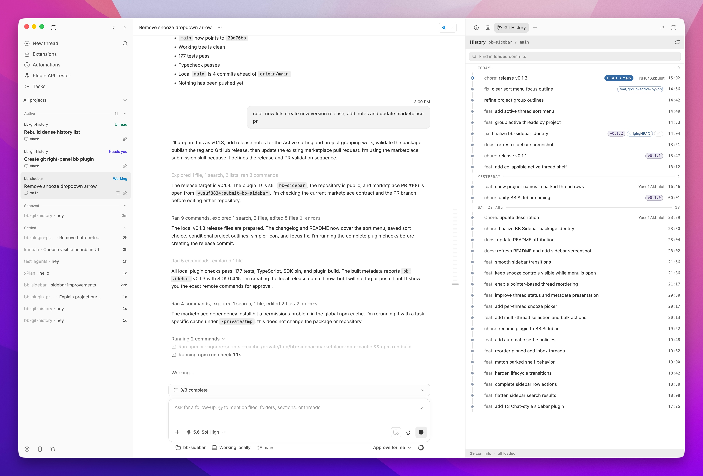
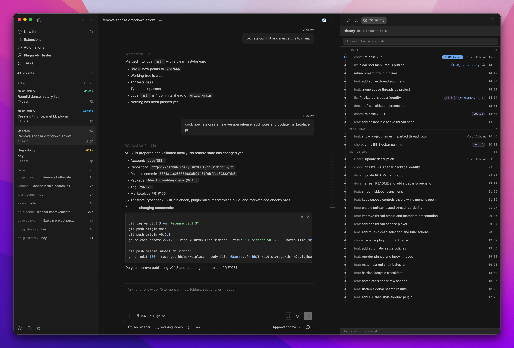
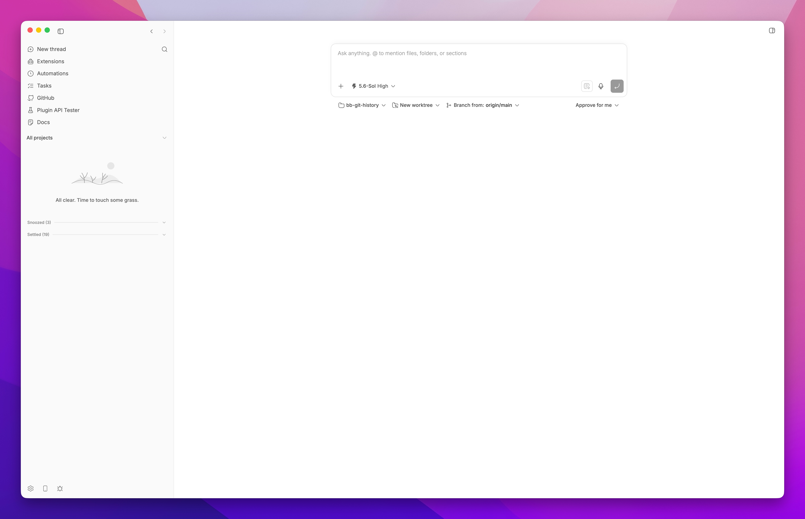

# BB Sidebar

A stable thread list for [bb](https://github.com/get-bb/bb). Threads stay where you put them while status, snooze, and settle actions remain close at hand.







## Features

- Manual ordering plus Recent activity, Date created, and Project sort modes
- Subtle project grouping for projects with multiple active threads
- Optional worktree grouping in Project sort: threads that share a worktree get collapsible groups
- Pinned, Active, Inactive, Snoozed, Parked, and Settled shelves
- Full cards, compact working threads, or compact all threads, with options to keep pinned or woken threads full
- Searchable multi-project filtering, remembered per window across reloads
- Optional project colors with per-project color selection. Names stay colored in every mode; show stripes in full and collapsed mode, full mode only, grouped projects only, or not at all
- Automatic project icons with custom overrides
- Expandable child-thread indicators with running and attention states, on shelf rows too
- Live status, branch, pull request, and provider details, plus statuses set by other plugins
- A `bb sidebar` command so agents can list, snooze, settle, park, resume, pin, and re-parent threads
- Persistent provider-limit warnings with one-click scheduled Continue after reset and a cancel option
- Workspace port discovery, hover-card details, and optional browser links
- A Clean button in Settled that previews and closes live terminals and verified thread-owned listening ports, while protecting Active and Working threads
- Configurable inactive-thread and automatic cleanup rules
- Native bb navigation, split, rename, archive, and delete flows
- Project submenu on thread cards for settings, rename, local paths, and removal
- Regenerate a thread title from its last three accepted user messages
- Automatically retry missing thread titles once in the background, respecting the selected AI title service and manual edits

Park threads while waiting on someone else. Use **Park thread** in the context menu and **Resume** when ready. Parked threads have no timer and are excluded from automatic cleanup. Opening one leaves it parked; new thread activity brings it back to Active.

Use **Parent** in a thread's context menu to search threads in the same project, choose a parent, or select **None** to remove it. The current parent is checked; the thread itself and its descendants are excluded.

## Install

```sh
bb plugin install git:https://github.com/yusuf8834/bb-sidebar.git
```

Requires bb 0.48.0 or later. Pull request badges and automatic settling read pull request status from bb's bundled GitHub PR Status plugin. While it is disabled, badges are hidden and threads with a workspace are not settled automatically.

Then choose **BB Sidebar** under **Settings > Appearance > Sidebar**.

## Development

```sh
npm install
npm run build
bb plugin install path:. --yes
```

## Credits

See [THIRD_PARTY_NOTICES.md](THIRD_PARTY_NOTICES.md) for details.
